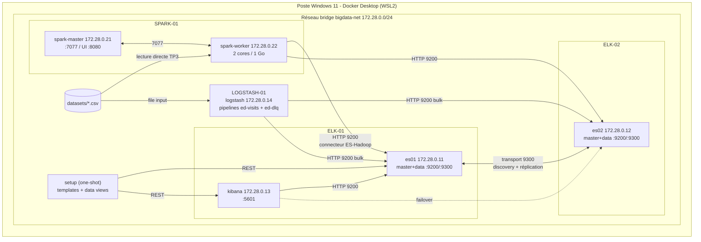

# Architecture de la plateforme

## 1. Contexte et besoin

Un service d'urgences veut superviser son activité : volumes de passages, gravité au triage (ESI),
durées de séjour, taux d'hospitalisation et qualité des données saisies.

La plateforme couvre toute la chaîne :
- **collecte et contrôle** des données de passage (Logstash) ;
- **stockage, indexation et recherche** (Elasticsearch, 2 nœuds) ;
- **visualisation** (Kibana) ;
- **traitements analytiques distribués** (Spark).

## 2. Schéma global



Vue simplifiée (format de l'énoncé) :

```
 Navigateur ──5601──> Kibana (ELK-01)
                         │ 9200
                         ▼
 Logstash ──9200──> ES node 01 (es01) <──9300──> ES node 02 (es02)
 (LOGSTASH-01)             ▲  cluster "ed-analytics-cluster"  ▲
                           └──────────── 9200 ───────────┐   │
                                                         │   │
                 Spark master (SPARK-01) ──7077── Spark worker
```

## 3. Machines

Chaque « machine » de l'énoncé est un **conteneur Docker** avec un hostname, une IP statique et des limites
CPU/RAM. On garde ainsi l'isolation, l'adressage IP et la résolution de noms demandés, sans le coût de
quatre VM complètes.

| Machine | Hostname | Adresse IP | OS (image) | CPU | RAM (limite) | Disque | Rôle |
|---|---|---|---|---|---|---|---|
| ELK-01 | `elk-01` (service `es01`) | 172.28.0.11 | Ubuntu 20.04 (image Elastic 8.17.4) | partagés (8 threads hôte) | 1 Go (heap 512 Mo) | volume `es01-data` | Elasticsearch master+data+ingest |
| ELK-01 | `elk-01-kibana` (service `kibana`) | 172.28.0.13 | Ubuntu 20.04 (image Elastic 8.17.4) | partagés | 1 Go | - (état dans ES) | Kibana |
| ELK-02 | `elk-02` (service `es02`) | 172.28.0.12 | Ubuntu 20.04 (image Elastic 8.17.4) | partagés | 1 Go (heap 512 Mo) | volume `es02-data` | Elasticsearch master+data+ingest |
| LOGSTASH-01 | `logstash-01` | 172.28.0.14 | Ubuntu 20.04 (image Elastic 8.17.4) | 2 workers pipeline | 1 Go (heap 256-512 Mo) | volume `ls-data` (DLQ) | Ingestion |
| SPARK-01 | `spark-01` (service `spark-master`) | 172.28.0.21 | Ubuntu 22.04, Java 17, Python 3 (image officielle `spark:3.5.5`) | partagés | 1,5 Go | bind `spark/output` | Spark master + driver |
| SPARK-01 | `spark-01-worker` | 172.28.0.22 | idem | 2 cores | 1,5 Go (1 Go pour les executors) | - | Spark worker |

**Hôte :** Windows 11 Pro, 8 threads, 16 Go de RAM, Docker Desktop (backend WSL 2). La stack consomme environ 6 Go.

Les OS et versions sont vérifiables dans les conteneurs :
- `docker compose exec es01 cat /etc/os-release`
- `docker compose exec spark-master java -version`

## 4. Réseau et communications

- Un réseau bridge dédié, `bigdata-net` (172.28.0.0/24, passerelle .1), avec des IP fixes (`ipv4_address`).
- **Résolution des noms** : le DNS interne de Docker. Chaque conteneur est joignable par son nom de service
  (`es01`, `kibana`…) et par son alias de machine (`elk-01`, `elk-02`, `spark-01`, `logstash-01`).

| Flux | Source → Destination | Port / protocole |
|---|---|---|
| Découverte + réplication | es01 ↔ es02 | 9300 TCP (transport) |
| Requêtes Kibana | kibana → es01, es02 | 9200 HTTP |
| Indexation | logstash → es01, es02 | 9200 HTTP (bulk) |
| Bootstrap | setup → es01, kibana | 9200 / 5601 HTTP |
| Cluster Spark | spark-worker ↔ spark-master | 7077 (RPC), driver ↔ executors |
| Lecture ES par Spark | executors → es01, es02 | 9200 HTTP (connecteur elasticsearch-spark) |
| Accès utilisateur | hôte → services | publiés **uniquement sur 127.0.0.1** |

## 5. Choix techniques justifiés

| Choix | Justification |
|---|---|
| Docker Compose au lieu de VM | Infrastructure reproductible en une commande (`docker compose up`) et versionnée. Le poste de 16 Go ne supporterait pas 4 VM. |
| Elastic **8.17.4** sur les 3 composants | Une seule version pour ES, Kibana et Logstash, comme l'exige l'énoncé. Le connecteur ES-Hadoop existe dans la même version. |
| Spark **3.5.5** (Java 17, Python 3), image officielle | Branche stable 3.5, compatible avec `elasticsearch-spark-30_2.12`. Image légère avec PySpark inclus. |
| 2 nœuds master+data, 1 shard + 1 réplica | Chaque document existe sur les 2 nœuds, donc le cluster est **green**. La lecture continue si un nœud tombe. |
| Heap ES 512 Mo, limite 1 Go | Règle Elastic : heap ≤ 50 % de la RAM pour laisser le cache système. C'est suffisant pour quelques milliers de documents. |
| `bootstrap.memory_lock` + ulimit memlock | Empêche le swap du heap, qui dégraderait fortement les performances. |
| Sécurité X-Pack désactivée | Choix de laboratoire : réseau isolé, ports liés à 127.0.0.1, aucune donnée réelle. En production, il faudrait TLS, des utilisateurs et des rôles (service `setup` générant une CA, comme dans le compose officiel Elastic). |
| ML désactivé, seuils disque désactivés | Économie de mémoire. Le disque virtuel de Docker Desktop paraît souvent « plein », ce qui bloquerait l'allocation des shards. |
| Service `setup` | Les templates et index sont créés **avant** l'ingestion, ce qui permet de vérifier le mapping appliqué. Le script est idempotent. |
| Healthchecks + `depends_on: condition` | Démarrage ordonné. Logstash n'écrit jamais dans un cluster incomplet ou sans template. |

**Limite connue :** avec 2 nœuds master-eligible, la perte d'un nœud empêche l'élection d'un master
(quorum = 2). Une architecture de production ajouterait un 3ᵉ nœud, éventuellement *voting-only*.

## 6. Configuration principale

- Les nœuds sont configurés dans [es01.yml](../elasticsearch/config/es01.yml) et [es02.yml](../elasticsearch/config/es02.yml), avec ces paramètres :
  - `cluster.name: ed-analytics-cluster` ;
  - `node.name: es01|es02` ;
  - `discovery.seed_hosts` (l'autre nœud) ;
  - `cluster.initial_master_nodes: [es01, es02]`.
- Kibana : [kibana.yml](../kibana/kibana.yml), avec `elasticsearch.hosts` pointant vers les 2 nœuds.
- Logstash : [logstash.yml](../logstash/config/logstash.yml) et [pipelines.yml](../logstash/config/pipelines.yml).
- Spark : [spark-defaults.conf](../spark/conf/spark-defaults.conf).

## 7. Preuves de fonctionnement (captures à réaliser)

| Preuve | Commande / écran |
|---|---|
| Les 2 nœuds dans le même cluster | `GET _cat/nodes?v`, `GET /` sur :9200 et :9201 (même `cluster_uuid`) |
| Cluster opérationnel | `GET _cluster/health` → green, `number_of_nodes: 2` |
| Communication entre nœuds | `GET _cat/shards/ed-visits-main?v` : primaire sur un nœud, réplica sur l'autre |
| Kibana connecté | Stack Management → Index Management ; Stack Monitoring |
| Spark | UI http://localhost:8080 (1 worker ALIVE, applications terminées), sortie du job TP3 |
| Logstash | `GET :9600/_node/stats/pipelines`, `docker compose logs logstash` |
